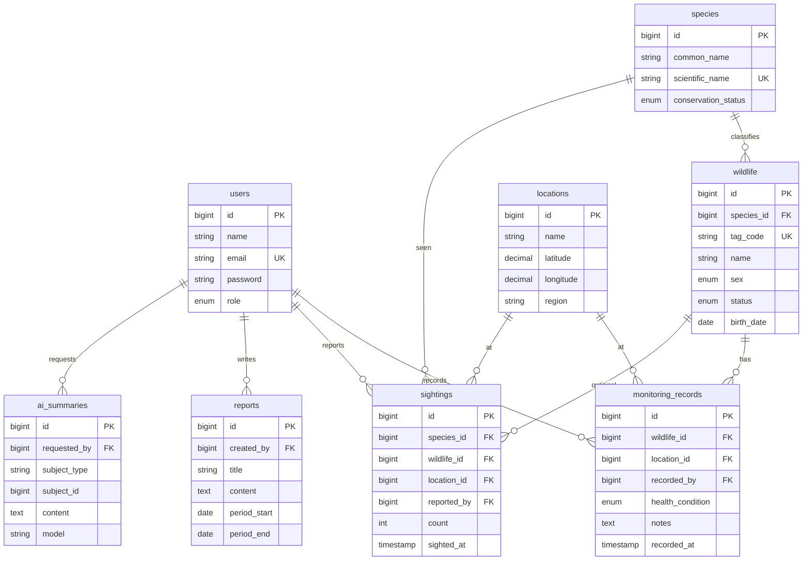

# Wildlife Tracking – Database

Repo **desain & dokumentasi database** untuk **Wildlife Tracking Monitoring System**: ERD, data dictionary, aturan database, dan rencana seed.

> **Penting:** file migration, seeder, dan factory Laravel **tetap berada di repo `wildlife-tracking-backend`** (folder `database/`), karena Laravel yang menjalankannya. Repo ini adalah **sumber desain**; repo backend adalah **implementasi**. PIC Database memiliki keduanya.

Repo terkait: `wildlife-tracking-backend` · `wildlife-tracking-frontend`

---

## 1. SETUP UNTUK PEMULA

### 1.1 Install
| Aplikasi | Fungsi | Link |
|---|---|---|
| Laragon (Full) atau XAMPP | Menjalankan MySQL | https://laragon.org |
| DBeaver / HeidiSQL | Melihat isi database | https://dbeaver.io |
| Git | Version control | https://git-scm.com |
| VS Code | Edit dokumen | https://code.visualstudio.com |

Ekstensi VS Code: **Markdown Preview Mermaid Support** (agar diagram ERD tampil). GitHub juga menampilkan Mermaid otomatis.

### 1.2 Menyiapkan MySQL lokal
1. Buka Laragon → **Start All** (MySQL menyala di port 3306).
2. Buka DBeaver/HeidiSQL → koneksi: host `127.0.0.1`, port `3306`, user `root`, password kosong.
3. Buat database: `CREATE DATABASE wildlife_tracking;`
4. Tabel **tidak dibuat manual**. Jalankan dari repo backend: `php artisan migrate --seed`.

### 1.3 Clone repo ini
```bash
git clone https://github.com/<org>/wildlife-tracking-database.git
cd wildlife-tracking-database
git checkout develop
```

### 1.4 Masalah umum
| Masalah | Solusi |
|---|---|
| Tidak bisa konek MySQL | MySQL belum menyala di Laragon/XAMPP |
| Port 3306 bentrok | Hentikan MySQL lain, atau ubah port dan samakan `DB_PORT` di `.env` backend |
| Tabel tidak muncul | Migration belum dijalankan di repo backend |
| Skema beda antar anggota | Semua jalankan `php artisan migrate:fresh --seed` setelah `git pull` |

---

## 2. STRUKTUR REPO
```
wildlife-tracking-database/
├── docs/
│   ├── erd.md               # diagram ERD (Mermaid)
│   ├── data-dictionary.md   # penjelasan tiap tabel & kolom
│   └── seed-plan.md         # data contoh untuk development
├── CHANGELOG.md             # catatan perubahan skema
└── README.md
```
Buat file ini bertahap; jangan menambah folder yang tidak dipakai.

## 3. ALUR KERJA PERUBAHAN SKEMA
1. PIC Database mengubah desain di repo ini (`erd.md`, `data-dictionary.md`) → PR → di-review Backend.
2. Setelah disetujui, PIC Database membuat **migration** di repo backend:
   ```bash
   php artisan make:migration create_monitoring_records_table
   ```
3. Model, relasi, dan factory dibuat bersama Backend.
4. Catat di `CHANGELOG.md`, beri tahu Frontend bila ada perubahan data yang tampil.

Aturan: **dilarang** mengubah tabel manual lewat phpMyAdmin/DBeaver. **Dilarang** mengedit migration yang sudah di-merge ke `develop` → buat migration baru.

---

## 4. KONSEP SINGKAT
| Istilah | Arti |
|---|---|
| Primary key | Pengenal unik tiap baris (`id`) |
| Foreign key | Kolom penghubung ke tabel lain (`species_id` → `species.id`) |
| Relationship | 1–banyak / banyak–banyak antar tabel |
| Index | Mempercepat pencarian (kolom yang sering difilter/join) |
| Unique | Tidak boleh ada nilai kembar (`email`, `tag_code`) |
| Nullable | Boleh kosong (hanya jika memang opsional) |
| Enum/status | Nilai terbatas (`active`, `inactive`) |
| Timestamp | `created_at`, `updated_at` otomatis |

## 5. ERD

Jika tim merasa terlalu rumit, `sightings` dan `monitoring_records` boleh digabung di awal. Utamakan yang bisa selesai.

## 6. DATA DICTIONARY (ringkas)
| Tabel | Fungsi | Constraint penting |
|---|---|---|
| `users` | Akun pengguna + role (`admin`, `researcher`, `observer`, `user`) | `email` unique |
| `species` | Jenis satwa & status konservasi | `scientific_name` unique |
| `locations` | Lokasi pengamatan (lat/long) | index `region` |
| `wildlife` | Individu satwa yang dipantau | FK `species_id`, `tag_code` unique, status enum |
| `monitoring_records` | Catatan pemantauan rutin satwa | FK `wildlife_id`, `location_id`, `recorded_by`; index `recorded_at` |
| `sightings` | Laporan melihat satwa (bisa tanpa individu terdaftar) | FK `species_id`, `location_id`, `reported_by`; `wildlife_id` nullable |
| `reports` | Laporan periodik | FK `created_by` |
| `ai_summaries` | Hasil ringkasan AI yang disimpan | FK `requested_by` |

Rincian per kolom ditulis di `docs/data-dictionary.md` memakai format:
`nama_kolom | tipe | null? | default | keterangan`.

## 7. CONTOH MIGRATION (diimplementasi di repo backend)
```php
Schema::create('monitoring_records', function (Blueprint $t) {
    $t->id();
    $t->foreignId('wildlife_id')->constrained()->cascadeOnDelete();
    $t->foreignId('location_id')->constrained();
    $t->foreignId('recorded_by')->constrained('users');
    $t->enum('health_condition', ['healthy', 'injured', 'sick', 'unknown']);
    $t->text('notes')->nullable();
    $t->timestamp('recorded_at')->index();
    $t->timestamps();
});
```
Urutan pembuatan migration (karena foreign key): `users` → `species` → `locations` → `wildlife` → `monitoring_records` / `sightings` → `reports` → `ai_summaries`.

## 8. ATURAN DATABASE
1. Semua perubahan skema lewat **migration**.
2. Foreign key & constraint harus jelas.
3. Tidak menyimpan data duplikat yang tidak perlu.
4. Index untuk kolom yang sering dicari/filter/join.
5. Seeder & factory tersedia untuk development (`php artisan migrate:fresh --seed`).
6. Nama tabel & kolom `snake_case`; nama tabel jamak (`monitoring_records`).
7. Jangan simpan password polos (Laravel `Hash`), dan jangan simpan API key di database.
8. Update ERD & data dictionary **di PR yang sama** dengan perubahan skema.

## 9. RENCANA SEED (`docs/seed-plan.md`)
Data development yang disarankan: 1 akun per role (password contoh, hanya lokal) · 5–10 spesies · 5 lokasi · 20 satwa · 50 monitoring record · 20 sighting. Gunakan **Factory** agar data acak, dan **Seeder** agar urutan benar.

## 10. GIT WORKFLOW (CONTEKAN PEMULA)
```bash
git checkout develop
git pull origin develop
git checkout -b feature/erd-monitoring
# ... edit dokumen ...
git add .
git commit -m "docs(erd): add monitoring_records relation"
git push -u origin feature/erd-monitoring
```
Buka Pull Request ke `develop`, minta review Backend. Commit: `feat:` `fix:` `docs:` `chore:`.
Dilarang push langsung ke `main`/`develop`.

## 11. DEFINITION OF DONE (Database)
- [ ] ERD & data dictionary diperbarui
- [ ] Migration dibuat di repo backend & berjalan (`migrate:fresh --seed` sukses)
- [ ] Foreign key, unique, index sudah dipasang
- [ ] Seeder/factory tersedia
- [ ] Backend & Frontend diberi tahu bila ada perubahan
- [ ] `CHANGELOG.md` diperbarui
- [ ] PR sudah di-review

## 12. Tanggung jawab
Schema · ERD · migration · relationship · seeder · index · constraint.
